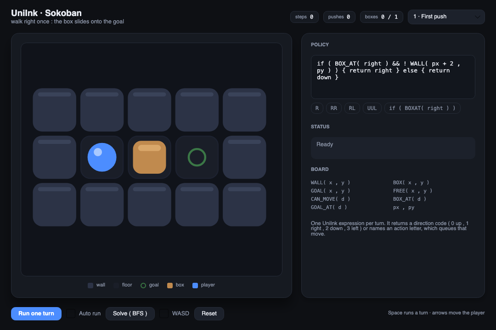
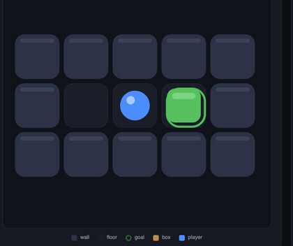
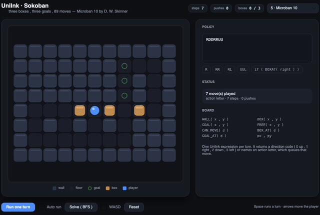
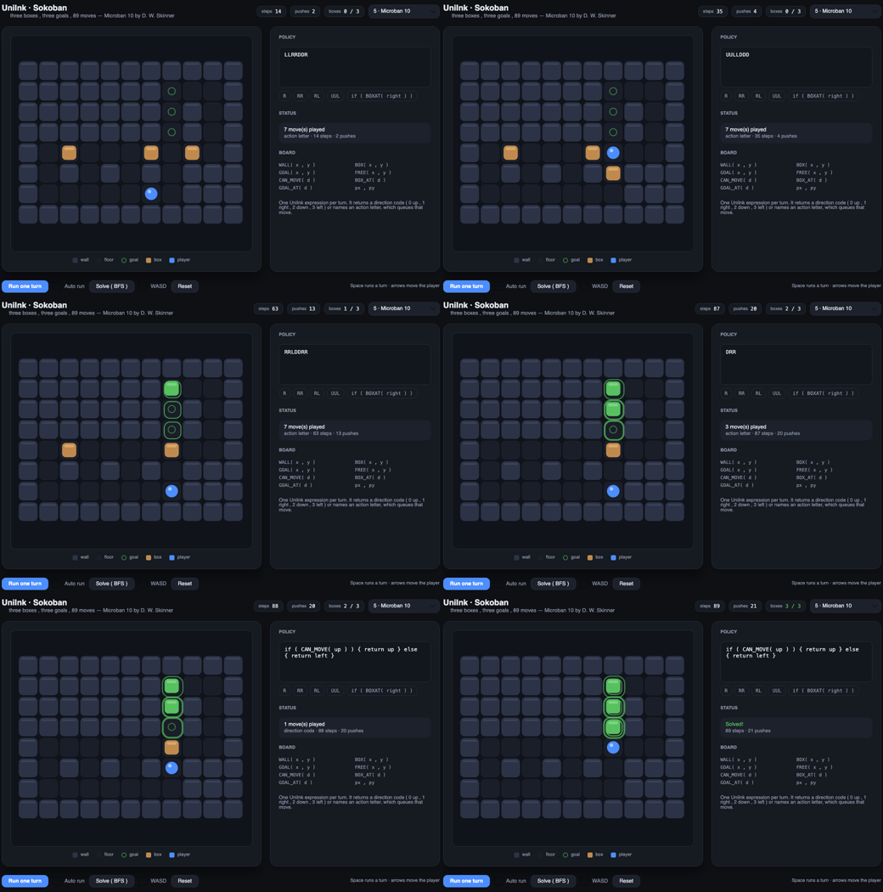

# Arc.UniInk.Sample.Sokoban

A small **Sokoban that a string controls** : every turn the game evaluates one UniInk expression and applies the
direction it answers with . The point is to show the evaluator driving real behaviour — and to let an AI agent
play by writing one expression per turn .



```
dotnet run --project Arc.UniInk.Sample.Sokoban/App -c Release
```

The project sets `<UseAppHost>false</UseAppHost>` , so `dotnet run` starts the dll directly : a standalone apphost
on macOS needs a signature and is killed by Gatekeeper ( `Killed: 9` ) . If you build your own copy , run
`dotnet bin/Release/net10.0/Arc.UniInk.Sample.Sokoban.App.dll` instead of the executable .



- Arrow keys move the player by hand , **Space** runs one turn of the policy . A box that lands on a goal sends a
  ripple out of its square , and clearing the level ripples every box home in a short stagger .
- **Run one turn** evaluates the policy once . **Auto run** repeats it . **Solve ( BFS )** plays the shortest
  solution found by the solver . **Reset** restarts the level . The header counts steps , pushes and boxes home ,
  the strip under the board explains the squares , and the side panel lists the board functions .

## The protocol ( v1 )

Every turn the app builds a fresh `UniInk` interpreter , registers the board and evaluates the policy . The
expression must evaluate to an `int` : `0` up , `1` right , `2` down , `3` left .

| Name | Kind | Meaning |
|---|---|---|
| `px` , `py` | variable | the player column / row |
| `steps` , `pushes` | variable | the counters of the level |
| `solved` | variable | `1` when every box is on a goal |
| `up` `right` `down` `left` | variable | the direction codes , so a policy can `return right` |
| **`U` `R` `D` `L`** | **action getter** ( arrow scheme ) | naming one queues that move : the policy can be the single letter `R` , or `RR` for two |
| **`W` `A` `S` `D`** | **action getter** ( WASD scheme ) | the same four moves , chosen with the **WASD** toggle in the window |
| `WALL( x , y )` | function | the square is a wall ( outside the board counts as a wall ) |
| `BOX( x , y )` | function | a box stands there |
| `GOAL( x , y )` | function | the square is a goal |
| `FREE( x , y )` | function | the player can step there ( no wall , no box ) |
| `CAN_MOVE( d )` | function | the move is legal , a box may be pushed |
| `BOX_AT( d )` | function | the square in direction `d` holds a box |
| `GOAL_AT( d )` | function | the square in direction `d` is a goal |

A policy is **one expression** : there is no loop , the loop is the turn .

## The action getters

`U` `R` `D` `L` are registered with `InkValue.SetGetter` : the getter runs when the name is **parsed** and
**appends** the direction to the move queue of the turn ( it also reports whether that move is legal right now ,
`1` / `0` ) . The host then plays the queue in order and stops at the first blocked move , so the policy string
reads like a key sequence :

```
R          one move
RR         two moves to the right
RL         right , then left ( they cancel out )
RUUL       up twice , then left
```

```
if ( solved ) { return 0 } else { return R }
```

A sequence longer than one move is best written as the bare letters : the queue is what the host plays .

The two schemes cannot both be active : `D` means **down** in the arrow scheme and **right** in WASD , so
`Protocol` takes an `InputScheme` and registers one set or the other ( `U` / `R` / `D` / `L` by default ) .

A getter runs at parse time , **before** the condition is evaluated — and the parser walks both arms of an
`if` . So never branch between action names : `if ( BOX_AT( right ) ) { return R } else { return D }` records
`R` **and** `D` , and the queue holds both ( the host plays right , then down ) . Branch between direction
**codes** when the choice must depend on the board :

```
if ( BOX_AT( right ) && ! WALL( px + 2 , py ) ) { return right } else { return down }
```

## Example policies

Push the box in front of you , otherwise walk down :

```
if ( BOX_AT( right ) && ! WALL( px + 2 , py ) ) { return right } else { return down }
```

Only step somewhere free , otherwise back off :

```
if ( FREE( px + 1 , py ) ) { return right } else { return left }
```

Prefer a push towards a goal :

```
if ( BOX_AT( right ) && GOAL( px + 2 , py ) ) { return right } else { return down }
```

The first level is solved by the first policy . The later levels need a real strategy — which is the interesting
part for an agent : it can read the board through the functions above and decide one move at a time .

## An agent plays a level

The hard level is [Microban #10](https://cdn.jsdelivr.net/gh/OMerkel/Sokoban@master/3rdParty/Levels/Microban.txt)
by David W. Skinner — three boxes , three goals , 89 moves . The app can be driven headless , so an agent reads the
board through UniInk and answers with UniInk expressions , one evaluation per turn :

```bash
# what the board looks like , and what it offers
dotnet run --project Arc.UniInk.Sample.Sokoban/App -c Release -- --list

# ask questions : each expression is evaluated , nothing moves
dotnet run --project Arc.UniInk.Sample.Sokoban/App -c Release -- --ask 4 \
  "px" "py" "BOX( 4 , 4 )" "GOAL( 7 , 1 ) && GOAL( 7 , 2 )" "CAN_MOVE( right )"

# play a script : one policy per line , one evaluation per turn
dotnet run --project Arc.UniInk.Sample.Sokoban/App -c Release -- \
  --script 4 docs/agent-policies.txt

# the shortest solution , as URDL letters
dotnet run --project Arc.UniInk.Sample.Sokoban/App -c Release -- --solve 4
```

The same script can be played **in the window** , one expression at a time : pick level 5 , paste a policy , press
**Run one turn** , repeat . The gif below is exactly that — fifteen turns , from `0/3` boxes home to `Solved!` :





The recorded run is in [docs/agent-play.md](docs/agent-play.md) : the questions the agent asked , then the turns ,
with the board after each one . Add a delay as a fourth argument ( `--script 4 docs/agent-policies.txt 400` ) when
you want the turns to play back slowly on screen .

## Structure

```
Core/     the rules ( Board , Game , Levels ) , the protocol ( UniInk names ) and a BFS solver
App/      the Avalonia window , plus a headless player for the --ask / --script / --solve modes
Tests/    rules , protocol and "every level is solvable" ( the BFS replays the path )
docs/     the screenshots , the ripple gif and the recorded agent run
```

The sample is **not** part of the NuGet package or the Unity package : it is a playground for the evaluator .
